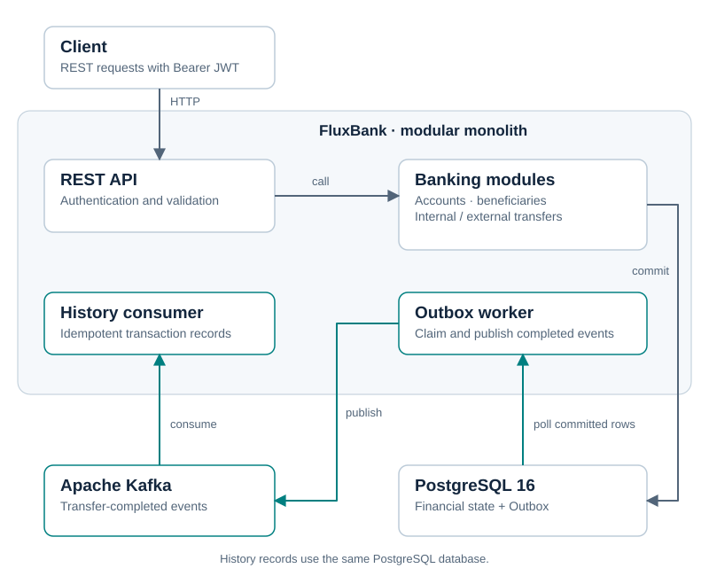
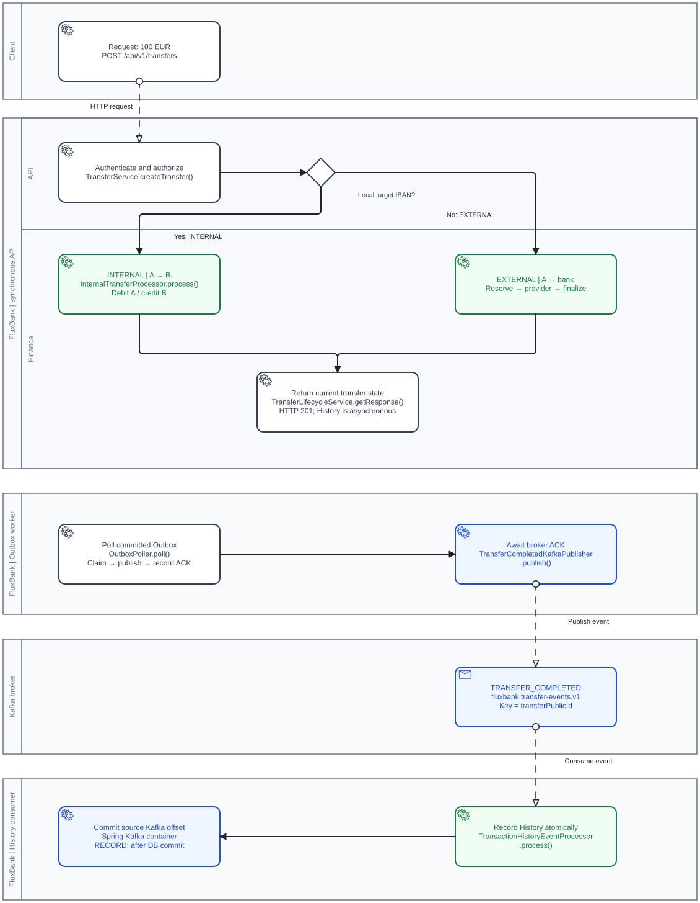

<p align="center">
  <picture>
    <source media="(prefers-color-scheme: dark)" srcset="docs/assets/fluxbank-mark-dark.svg">
    
  </picture>
</p>

<h1 align="center">FluxBank</h1>

<p align="center"><strong>A modular banking backend, from secure accounts to reliable money movement.</strong></p>

<p align="center">
  <picture>
    <source media="(max-width: 600px)" srcset="docs/assets/technology-badges-mobile.svg">
    
  </picture>
</p>

<p align="center">
  <a href="#getting-started">Get started</a> ·
  <a href="#system-architecture">Architecture</a> ·
  <a href="#roadmap">Roadmap</a> ·
  <a href="docs/development.md">Developer setup</a> ·
  <a href="docs/architecture/README.md">BPMN reference</a>
</p>

FluxBank is a Java and Spring Boot banking backend for customer authentication, accounts, beneficiaries and money transfers. It brings synchronous financial operations and asynchronous transaction records together in a **modular monolith**: one deployable application, organized around banking capabilities.

The project explores practical backend engineering through a banking domain: protecting account ownership, handling concurrent balance changes, integrating an external payment sandbox and delivering events reliably. PostgreSQL holds the financial state; a Transactional Outbox and Kafka carry completed transfers to the History consumer.

FluxBank is under active development. The repository includes the event-driven History implementation while its Jira milestone remains in progress. External payments use a local MockBank adapter; production bank connectivity, observability, API documentation and delivery automation remain future work.

## What works today

| Capability | What you can explore |
|---|---|
| Identity & access | Customer registration, login, JWT authentication and ownership checks. |
| Accounts & balances | Account creation, lookup, blocking and closure; current, reserved and available balances. |
| Beneficiaries | Owner-scoped recipient management with IBAN validation. |
| Internal transfers | Transfers between local accounts with coordinated debit and credit. |
| External payments | Reservation, provider invocation and settlement or release through MockBank. |
| Reliable event delivery | Transactional Outbox, Kafka publication, retry and stale-claim recovery. |
| Event-driven History | Consumer-side transaction records and idempotent duplicate handling; **FLUX-20 is in progress**. |

These capabilities are present in the current working tree. Milestone completion follows Jira, rather than the presence of source files alone.

## System architecture

<picture>
  <source media="(prefers-color-scheme: dark) and (max-width: 600px)" srcset="docs/assets/system-architecture-mobile-dark.svg">
  <source media="(max-width: 600px)" srcset="docs/assets/system-architecture-mobile-light.svg">
  <source media="(prefers-color-scheme: dark)" srcset="docs/assets/system-architecture-dark.svg">
  
</picture>

The API, banking modules, Outbox worker and History consumer belong to **the same Spring Boot application**. PostgreSQL and Kafka are infrastructure services. Completed transfers become durable events before publication; History is created asynchronously and does not change balances again. The payment adapter communicates separately with MockBank, which has its own database.

For financial boundaries and failure paths, continue to the [source-based architecture guide](docs/architecture/README.md).

## Roadmap

Jira snapshot verified **8 November 2026**. “Completed” maps to **Done**; “Planned” maps to **To Do**. Issue links may require access to the project workspace.

| Issue | Milestone | Status |
|---|---|---|
| [FLUX-18](https://fluxbank.atlassian.net/browse/FLUX-18) | Transactional Outbox | 🟢 Completed |
| [FLUX-19](https://fluxbank.atlassian.net/browse/FLUX-19) | Apache Kafka integration | 🟢 Completed |
| [FLUX-20](https://fluxbank.atlassian.net/browse/FLUX-20) | Event-driven Transaction History | 🟡 In Progress |
| [FLUX-21](https://fluxbank.atlassian.net/browse/FLUX-21) | Observability & correlation logging | ⚪ Planned |
| [FLUX-22](https://fluxbank.atlassian.net/browse/FLUX-22) | OpenAPI & Swagger documentation | ⚪ Planned |
| [FLUX-23](https://fluxbank.atlassian.net/browse/FLUX-23) | Jenkins CI pipeline | ⚪ Planned |
| [FLUX-24](https://fluxbank.atlassian.net/browse/FLUX-24) | OpenShift deployment | ⚪ Planned |

## Technology stack

| Responsibility | Current technologies |
|---|---|
| Backend | Java 17, Spring Boot 3.5.7, Spring MVC, Bean Validation |
| Persistence | PostgreSQL 16, Spring Data JPA / Hibernate, Flyway |
| Messaging | Apache Kafka 3.9.1 in Compose, Spring Kafka, JSON events |
| Security | Spring Security, JJWT, BCrypt password hashing |
| Testing | JUnit Jupiter, Mockito, Spring Boot Test, Testcontainers for PostgreSQL and Kafka |
| Local infrastructure | Docker, Docker Compose, Maven Wrapper, Flask-based MockBank sandbox |

OpenAPI/Swagger, Jenkins and OpenShift are **planned**, not installed platform components.

## Getting started

The recommended local path uses **Docker with Compose v2**. The backend image builds with Java 17; a host JDK is needed only for running Maven or developing outside the container. Keep host ports **8080** and **9092** available. First startup needs internet access for images and Maven dependencies.

**1. Get the repository.**

```bash
git clone https://github.com/alpozr/fluxbank-platform.git
cd fluxbank-platform
```

**2. Start the local stack.** No `.env` file is required for the supplied development defaults.

```bash
docker compose up --build -d
```

Compose starts `backend`, `postgres`, `kafka`, `mockbank` and the sandbox's separate `db`. Flyway applies the FluxBank migrations on application startup. The supplied credentials and plaintext broker are for local development; see [environment configuration](docs/development.md#environment-configuration) before using another environment.

**3. Check startup.**

```bash
docker compose ps
docker compose logs --tail=100 backend
curl -i http://localhost:8080/api/v1/auth/me
```

An unauthenticated request to `/me` should return **401**, confirming the protected API responds. This is an authentication smoke check, not an Actuator health endpoint. Follow the [registration and login walkthrough](docs/development.md#first-api-request) to obtain a token. Swagger UI is not implemented yet.

**4. Run the tests with JDK 17 and Docker available.**

```bash
./mvnw test
```

The wrapper supplies Maven. Integration tests create their own PostgreSQL/Kafka containers; they do not use the application's persistent development data. The image build skips tests, so run this command separately when validating changes. See [testing](docs/development.md#testing) for a focused test command and troubleshooting.

**5. Stop when finished.**

```bash
docker compose down
```

Named volumes retain local data. Advanced configuration, service connectivity and JVM startup requirements are in the [development guide](docs/development.md).

## Developer guide

Start with a capability package, then follow its API and application layers. The codebase uses package boundaries within one Maven project:

```text
src/main/java/com/fluxbank/
├── auth/             Registration and login
├── customer/         Customer identity
├── account/          Accounts and balances
├── beneficiary/      Saved recipients
├── transfer/         Internal and external payment flows
├── outbox/           Event publication and recovery
├── transaction/      Transaction History and Kafka consumer
├── processed/        Processed-event markers
└── common/           Shared security, validation and configuration
```

Within applicable modules, `api/` contains controllers and DTOs, `application/` orchestrates use cases, `domain/` holds entities and rules, and `repository/` handles persistence. External adapters live under `infrastructure/`. Tests mirror these packages; database, concurrency and broker scenarios are grouped in [`src/test/java/com/fluxbank/integration/`](src/test/java/com/fluxbank/integration/).

Before changing a flow, read its BPMN, check the linked Jira milestone and run the relevant tests. Keep behavioral changes accompanied by corresponding tests and documentation. The [development guide](docs/development.md#repository-conventions) distinguishes existing repository structure from suggested contribution practices.

## Architecture documentation

| Editable BPMN | Focus |
|---|---|
| [Transfer overview](docs/architecture/fluxbank-transfer-overview.bpmn) | API, financial processing and asynchronous event path |
| [Internal transfer](docs/architecture/fluxbank-internal-transfer-detail.bpmn) | Local debit/credit and financial boundaries |
| [External transfer](docs/architecture/fluxbank-external-transfer-detail.bpmn) | Reservation, provider outcomes and finalization |
| [Outbox, Kafka & History](docs/architecture/fluxbank-kafka-outbox-history-detail.bpmn) | Claim, publication and links into consumer/recovery details |

Open these files in **Camunda Desktop Modeler** or a BPMN-compatible editor. The [architecture index](docs/architecture/README.md#reading-the-diagrams) also links the dedicated security, History and recovery pages, with method references and implementation limitations.

<details>
<summary>Preview the editable transfer overview</summary>

[](docs/architecture/fluxbank-transfer-overview.bpmn)

The preview is a static export. Open the linked BPMN for editing and the [full-size SVG](docs/assets/transfer-overview.svg) for a closer look.

</details>

## Project direction

The immediate focus is completing the History milestone, then improving operational visibility, API discoverability, CI and deployment. External UNKNOWN outcomes still need reconciliation, and there is no automatic DLT replay or REST request idempotency. These gaps are documented in the [technical reference](docs/architecture/README.md#known-limitations-and-future-work).

FluxBank remains a development-stage backend with a sandbox payment integration. The modular structure provides a place to evolve service boundaries deliberately, while keeping today's application understandable and runnable as one system.
